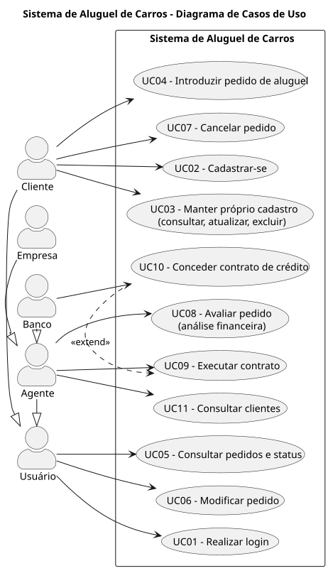
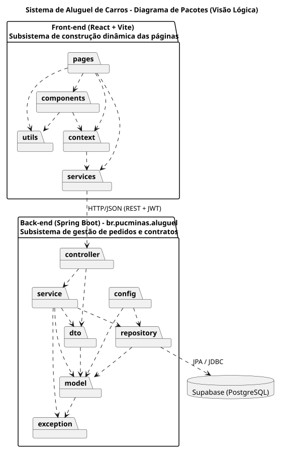
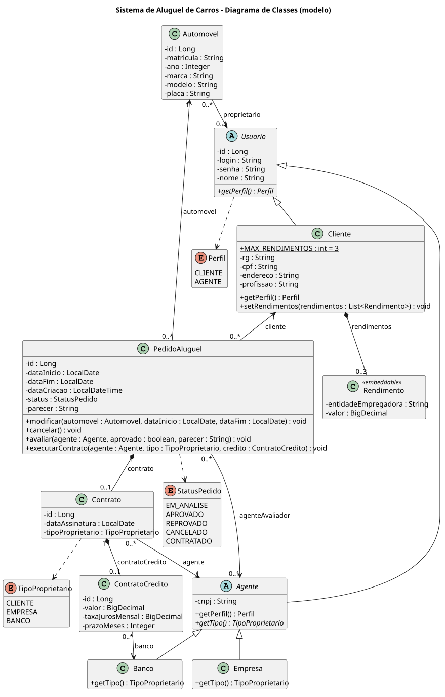

# 🚗 Sistema de Aluguel de Carros 👨‍💻

> [!NOTE]
> Sistema web para gestão de aluguéis de automóveis: clientes criam e acompanham pedidos de aluguel pela Internet, e agentes (empresas e bancos) analisam e aprovam esses pedidos.

<table>
  <tr>
    <td width="800px">
      <div align="justify">
        O <b>Sistema de Aluguel de Carros</b> permite <i>efetuar</i>, <i>modificar</i>, <i>consultar</i> e <i>cancelar</i> pedidos de aluguel de automóveis pela Internet. Após serem introduzidos pelos clientes, os pedidos são <b>analisados do ponto de vista financeiro</b> pelos agentes (empresas e bancos) e, em caso de parecer positivo, seguem para a <b>execução do contrato</b>, que pode estar associado a um <i>contrato de crédito</i> concedido por um banco agente. O acesso é restrito a usuários previamente cadastrados e autenticados.
      </div>
    </td>
    <td>
      <div>
        
      </div>
    </td>
  </tr>
</table>

---

## 🚧 Status do Projeto


---

## 📚 Índice
- [Sobre o Projeto](#-sobre-o-projeto)
- [Funcionalidades Principais](#-funcionalidades-principais)
- [Tecnologias Utilizadas](#-tecnologias-utilizadas)
- [Arquitetura](#-arquitetura)
  - [Modelagem (UML)](#modelagem-uml)
- [Instalação e Execução](#-instalação-e-execução)
  - [Pré-requisitos](#pré-requisitos)
  - [Variáveis de Ambiente](#-variáveis-de-ambiente)
  - [Instalação de Dependências](#-instalação-de-dependências)
  - [Como Executar a Aplicação](#-como-executar-a-aplicação)
  - [Usuários de demonstração](#-usuários-de-demonstração)
- [Estrutura de Pastas](#-estrutura-de-pastas)
- [Autores](#-autores)

---

## 📝 Sobre o Projeto

Projeto desenvolvido no **Laboratório de Desenvolvimento de Software (Lab02)** da PUC Minas, com o objetivo de construir um sistema de apoio à gestão de aluguéis de automóveis.

O sistema envolve dois tipos de usuários:

- **Clientes (usuários individuais):** introduzem, modificam, consultam e cancelam pedidos de aluguel.
- **Agentes (empresas e bancos):** modificam e avaliam pedidos, emitindo parecer financeiro. Pedidos com parecer positivo seguem para a execução do contrato.

Dependendo do tipo de contrato, os automóveis alugados podem ser registrados como propriedade dos **clientes**, **empresas** ou **bancos**, e o aluguel pode estar associado a um **contrato de crédito** concedido por um dos bancos agentes.

O projeto acompanha a modelagem UML (casos de uso, histórias de usuário, classes e pacotes), que é revisada ao longo do desenvolvimento para manter o alinhamento entre modelo e código.

---

## ✨ Funcionalidades Principais

- 🔐 **Autenticação:** cadastro prévio e login obrigatório (usuário e senha) para clientes e agentes.
- 👤 **CRUD de Cliente:** dados de identificação (RG, CPF, nome, endereço), profissão, entidades empregadoras e rendimentos auferidos (máximo 3).
- 📝 **Pedidos de Aluguel:** clientes criam, modificam, consultam, cancelam e acompanham o status dos seus pedidos.
- 🏦 **Avaliação de Pedidos:** agentes modificam e analisam financeiramente os pedidos, emitindo parecer.
- 📄 **Contratos:** execução do contrato após parecer positivo, com possível associação a um contrato de crédito bancário.
- 🚘 **Automóveis:** registro de matrícula, ano, marca, modelo e placa, com propriedade de cliente, empresa ou banco.

**Ciclo de vida do pedido:** `Em análise` → `Aprovado` / `Reprovado` → `Contratado`. Pedidos em análise ou aprovados podem ser `Cancelado`s pelo cliente.

---

## 🛠 Tecnologias Utilizadas

### 💻 Front-end

* **Biblioteca:** React 19
* **Roteamento:** React Router
* **Build Tool:** Vite 8

### 🖥️ Back-end

* **Linguagem:** Java (JDK 25)
* **Framework:** Spring Boot 4.0.9 (Spring Web MVC)
* **Build e dependências:** Apache Maven (Maven Wrapper incluso)
* **Banco de Dados:** Supabase (PostgreSQL); H2 em memória no perfil `local`
* **ORM:** Spring Data JPA / Hibernate
* **Autenticação:** Spring Security com login por usuário e senha (BCrypt) e token JWT

---

## 🏗 Arquitetura

O sistema segue o modelo **cliente-servidor**: um servidor central conectado, via Internet, aos computadores locais dos clientes e dos agentes. Ele é dividido em dois subsistemas:

- **Gestão de pedidos e contratos** — back-end em **Spring Boot**, organizado em arquitetura **MVC**:
  - **Model** (`model`): entidades de domínio persistidas no Supabase via JPA. As regras do pedido (modificar, cancelar, avaliar, executar contrato) ficam em `PedidoAluguel`.
  - **Controller** (`controller`): endpoints REST que recebem as requisições do front-end.
  - **Service / Repository** (`service`, `repository`): casos de uso, controle de acesso por usuário e acesso a dados.
  - **DTO** (`dto`): objetos de entrada e saída da API, separando o modelo da interface.
- **Construção dinâmica das páginas web** — front-end em **React + Vite**, responsável pela camada de visualização (View) e pelo consumo da API REST.

**Fluxo de dados:** `React (View)` → `Controller` → `Service` → `Repository` → `Supabase (PostgreSQL)`.

**Autenticação:** `POST /api/auth/login` devolve um JWT, enviado pelo front-end no header `Authorization: Bearer <token>`. O token carrega o perfil (`CLIENTE` ou `AGENTE`), usado para restringir as rotas.

### Modelagem (UML)

Os modelos ficam versionados em [`docs/`](docs/), com o código-fonte PlantUML (`.puml`) ao lado de cada imagem:

| Diagrama de Casos de Uso | Diagrama de Pacotes (Visão Lógica) |
| :---: | :---: |
|  |  |

| Diagrama de Classes |
| :---: |
|  |

As **Histórias de Usuário** estão em [`docs/historias-de-usuario.md`](docs/historias-de-usuario.md).

---

## 🔧 Instalação e Execução

### Pré-requisitos

* **Java JDK:** versão **25**
* **Node.js:** versão LTS e **npm**
* **Projeto no Supabase** (opcional para testes locais, veja o perfil `local`)

O Maven não precisa estar instalado: o projeto usa o Maven Wrapper (`mvnw`).

---

### 🔑 Variáveis de Ambiente

#### 1 Back-end (Spring Boot)

Configure como variáveis de ambiente do sistema. Os dados de conexão estão no painel do Supabase, em **Connect**.

| Variável | Descrição | Exemplo |
| :--- | :--- | :--- |
| `SPRING_DATASOURCE_URL` | URL JDBC do banco no Supabase. | `jdbc:postgresql://aws-0-sa-east-1.pooler.supabase.com:5432/postgres` |
| `SPRING_DATASOURCE_USERNAME` | Usuário do banco. | `postgres.<project-ref>` |
| `SPRING_DATASOURCE_PASSWORD` | Senha do banco. | `sua-senha` |
| `JWT_SECRET` | Chave de assinatura dos tokens (mínimo 32 caracteres). | `uma-chave-longa-e-aleatoria-com-32-caracteres` |
| `CORS_ORIGINS` | Origens do front-end liberadas (padrão `http://localhost:5173`). | `https://meu-front.vercel.app` |

> [!TIP]
> A conexão direta do Supabase (`db.<project-ref>.supabase.co`) usa apenas IPv6. Se a sua rede não suportar IPv6, use a URL do **Session pooler**, como no exemplo.

#### 2 Front-end (React, Vite)

Opcional. Crie um arquivo **`.env`** na pasta `frontend` (veja `frontend/.env.example`):

| Variável | Descrição | Exemplo |
| :--- | :--- | :--- |
| `VITE_API_URL` | URL base da API. O padrão `/api` usa o proxy do Vite para `http://localhost:8080`. | `/api` |

---

### 📦 Instalação de Dependências

```bash
git clone https://github.com/FelipeFonseca2/DIAW-Lab02.git
cd DIAW-Lab02
```

#### Front-end (React)

```bash
cd frontend
npm install
```

#### Back-end (Spring Boot)

```bash
cd backend
./mvnw clean install
```

---

### ⚡ Como Executar a Aplicação

Execute a aplicação em **dois terminais separados**.

#### Terminal 1: Back-end (Spring Boot)

Com o Supabase (variáveis de ambiente configuradas):

```bash
cd backend
./mvnw spring-boot:run
```

Ou, para testar sem o Supabase, com o perfil `local` (H2 em memória, os dados são perdidos ao reiniciar):

```bash
cd backend
./mvnw spring-boot:run "-Dspring-boot.run.profiles=local"
```

🚀 *O Back-end estará disponível em **http://localhost:8080**.* As tabelas são criadas automaticamente pelo Hibernate.

#### Terminal 2: Front-end (React, Vite)

```bash
cd frontend
npm run dev
```
🎨 *O Front-end estará disponível em **http://localhost:5173**.*

---

### 👤 Usuários de demonstração

Na primeira execução com o banco vazio, o sistema cadastra os usuários abaixo e quatro automóveis:

| Perfil | Usuário | Senha |
| :--- | :--- | :--- |
| Cliente | `cliente` | `cliente123` |
| Agente (Empresa) | `empresa` | `empresa123` |
| Agente (Banco) | `banco` | `banco123` |

Novos clientes podem se cadastrar pela tela de login.

---

## 📂 Estrutura de Pastas

```
.
├── README.md                    # 📘 Documentação principal do projeto.
├── /docs
│   ├── /diagramas               # 📐 Diagramas UML (.puml e .svg): casos de uso, classes e pacotes.
│   ├── /images                  # 🖼️ Logo do projeto.
│   └── historias-de-usuario.md  # 📝 Histórias de usuário.
│
├── /frontend                    # 📁 Aplicação React + Vite
│   ├── /src
│   │   ├── /components          # 🧱 Layout, rotas protegidas, formulário de cliente.
│   │   ├── /context             # 🔐 Estado de autenticação.
│   │   ├── /pages               # 📄 Login, cadastro, pedidos, perfil e clientes.
│   │   ├── /services            # 🔌 Chamadas HTTP à API.
│   │   └── /utils               # 🛠️ Formatação de datas, moeda e status.
│   ├── vite.config.js           # ⚙️ Proxy /api para o back-end.
│   └── package.json
│
└── /backend                     # 📁 Aplicação Spring Boot (MVC)
    ├── /src/main/java/br/pucminas/aluguel
    │   ├── /controller          # 🎮 Endpoints REST.
    │   ├── /service             # ⚙️ Casos de uso e geração do token JWT.
    │   ├── /repository          # 🗄️ Repositórios JPA.
    │   ├── /model               # 🧬 Entidades e regras de domínio.
    │   ├── /dto                 # ✉️ Data Transfer Objects.
    │   ├── /config              # 🔧 Segurança, CORS e dados iniciais.
    │   └── /exception           # 💥 Exceções e tratamento global de erros.
    ├── /src/main/resources      # ⚙️ application.properties e perfil local.
    └── pom.xml                  # 🛠️ Build e dependências (Maven).
```

---

## 👥 Autores

| 👤 Nome | :octocat: GitHub |
|---------|-----------------|
| Felipe Fonseca | <div align="center"><a href="https://github.com/FelipeFonseca2"></a></div> |
